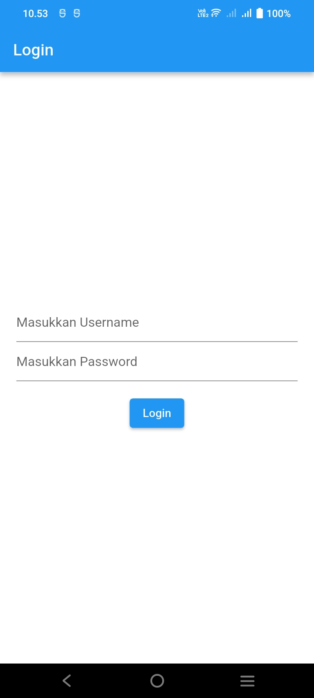
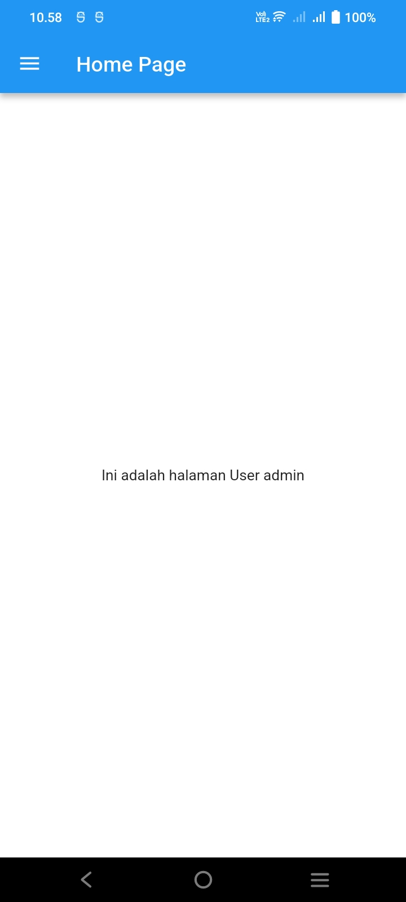
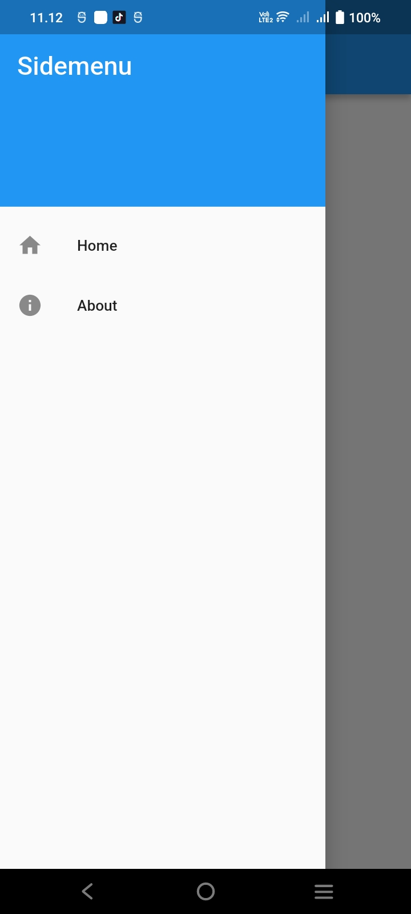
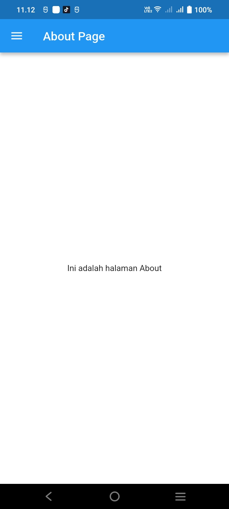

# Laporan Praktikum Pemrograman Mobile

**Nama**        : Ian Jullian Sutrisno  
**NIM**         : H1D024039  
**Shift**       : Awal I / Akhir C  
**Praktikum**   : Pemrograman Mobile

---

## 📝 Tugas Pertemuan 7

**Tanggal**: Selasa, 2 November 2026

**Modul**: Modul 3 — Routes, Side Menu, Login dan Local Storage

### 1. Membuat Project Flutter

Pada bagian ini, project aplikasi dibuat menggunakan framework Flutter dengan bahasa pemrograman Dart. Project diberi nama `router_flutter` dan disimpan di dalam folder `Praktikum Pemrograman Mobile`. Project ini digunakan untuk mengimplementasikan sistem login, navigasi antarhalaman, side menu, serta penyimpanan data pengguna secara lokal.

Implementasi project menggunakan Visual Studio Code dengan struktur utama aplikasi berada di dalam folder `router_flutter`. File utama aplikasi terdapat pada `lib/main.dart`.

### 2. Menambahkan Dependencies

Untuk menggunakan fitur penyimpanan data secara lokal, aplikasi menambahkan package `shared_preferences` pada file `pubspec.yaml`.

Dependencies yang digunakan adalah:

- `shared_preferences: ^2.0.17`: digunakan untuk menyimpan dan mengambil data sederhana, yaitu username pengguna, dari local storage.

Setelah dependencies ditambahkan, perintah `flutter pub get` dijalankan untuk mengunduh dan menghubungkan package ke dalam project. Package ini kemudian digunakan pada halaman Login dan Home.

### 3. Membuat Halaman Login

Halaman Login dibuat pada file `lib/login_page.dart` menggunakan `StatefulWidget`. Halaman ini menyediakan dua masukan, yaitu username dan password, yang dibuat menggunakan `TextField` serta `TextEditingController`.

Pada halaman Login terdapat beberapa fungsi yang digunakan untuk menjalankan proses autentikasi:

- `_saveUsername()`: menyimpan username ke dalam local storage menggunakan `SharedPreferences`.
- `_showInput()`: menampilkan kolom input username dan password.
- `_showDialog()`: menampilkan dialog atau pemberitahuan setelah proses login.
- `_login()`: memeriksa kesesuaian username dan password sebelum mengarahkan pengguna ke halaman berikutnya.

Simulasi login menggunakan username **admin** dan password **admin**. Apabila kedua masukan sesuai, aplikasi menampilkan pesan berhasil login dan mengarahkan pengguna ke Home Page. Apabila masukan tidak sesuai, aplikasi menampilkan pesan bahwa username dan password salah.

**Tampilan Halaman Login**

### 4. Membuat Halaman Home Page

Halaman Home Page dibuat pada file `lib/home_page.dart` menggunakan `StatefulWidget`. Halaman ini berfungsi untuk menampilkan username yang telah disimpan ketika pengguna berhasil melakukan login.

Fungsi `_loadUsername()` digunakan untuk mengambil username dari local storage dengan memanfaatkan `SharedPreferences`. Fungsi tersebut dipanggil pada `initState()` agar proses pengambilan data dilakukan ketika halaman pertama kali dibuat.

Setelah username berhasil diambil, halaman menampilkan teks **Ini adalah halaman User admin**. Dengan demikian, data username yang dimasukkan pada halaman Login dapat digunakan kembali pada halaman Home.

**Tampilan Halaman Home Page**

### 5. Membuat Side Menu

Side Menu dibuat pada file `lib/sidemenu.dart` menggunakan widget `Drawer`. Komponen ini berfungsi untuk menampilkan menu navigasi yang dapat digunakan pengguna untuk berpindah halaman di dalam aplikasi.

Di dalam Drawer terdapat `DrawerHeader` dan beberapa `ListTile` yang digunakan sebagai pilihan menu. Menu yang dibuat terdiri atas:

- **Home**: mengarahkan pengguna ke halaman Home Page melalui route `/home`.
- **About**: mengarahkan pengguna ke halaman About Page melalui route `/about`.

Komponen Side Menu kemudian dipasang pada properti `drawer` di halaman Home Page sehingga menu dapat dibuka melalui AppBar.

**Tampilan Side Menu**

### 6. Membuat About Page dan Routing

Halaman About dibuat pada file `lib/about_page.dart` menggunakan `StatelessWidget`. Halaman ini menampilkan AppBar dengan judul **About Page** serta teks **Ini adalah halaman About** pada bagian utama halaman.

Pengaturan routing dilakukan pada file `lib/main.dart` melalui properti `routes` pada `MaterialApp`. Route `/home` digunakan untuk membuka Home Page, sedangkan route `/about` digunakan untuk membuka About Page. Navigasi dari Side Menu dilakukan menggunakan `Navigator.pushNamed()` dan `Navigator.pushReplacementNamed()`.

Dengan pengaturan tersebut, pengguna dapat berpindah dari Home Page ke About Page dan kembali ke Home Page melalui pilihan menu yang tersedia pada Drawer.

**Tampilan Halaman About**

### Kesimpulan Praktikum

Pada Pertemuan 7, praktikum Modul 3 memberikan pemahaman mengenai implementasi routing, side menu, sistem login, dan local storage pada framework Flutter. Materi yang dipraktikkan meliputi pembuatan project Flutter, penambahan package `shared_preferences`, pembuatan halaman Login dan Home, penyimpanan serta pengambilan username, pembuatan Drawer sebagai side menu, dan pembuatan halaman About.

Implementasi dikerjakan menggunakan Visual Studio Code dengan bahasa pemrograman Dart dan diuji menggunakan perangkat Android. Praktikum ini membantu memahami proses autentikasi sederhana, penyimpanan data secara lokal, serta navigasi antarhalaman menggunakan route pada aplikasi Flutter.
