# Laporan Praktikum Pemrograman Mobile

**Nama** : Ian Jullian Sutrisno 
**NIM** : H1D024039 
**Shift** : Awal I / Akhir C 
**Praktikum** : Pemrograman Mobile

---

## 📝 Tugas Pertemuan 8

**Tanggal**: Selasa, 10 November 2026

**Modul**: Modul 4 — Operasi CRUD dengan API CodeIgniter 4

### 1. Membuat Project Flutter Toko Kita

Pada bagian ini, project aplikasi dibuat menggunakan framework Flutter dengan bahasa pemrograman Dart. Project diberi nama `tokokita` dan disimpan di dalam folder `Praktikum Pemrograman Mobile`, sejajar dengan project `router_flutter` dari praktikum sebelumnya. Project `tokokita` digunakan untuk membuat antarmuka aplikasi Toko Kita yang terdiri atas halaman registrasi, login, form produk, detail produk, dan daftar produk.

File utama aplikasi berada pada `tokokita/lib/main.dart`, sedangkan kode halaman dikelompokkan ke dalam folder `tokokita/lib/ui` dan model data dikelompokkan ke dalam folder `tokokita/lib/model`.

### 2. Membuat Database Toko API

Database dibuat menggunakan MySQL melalui phpMyAdmin yang dijalankan dengan Laragon. Database diberi nama `toko_api` dan digunakan untuk menyimpan data anggota, token login, serta produk.

Di dalam database `toko_api` dibuat tiga tabel, yaitu:

- `member`: menyimpan data anggota yang terdiri atas `id`, `nama`, `email`, dan `password`.
- `member_token`: menyimpan token autentikasi yang terdiri atas `id`, `member_id`, dan `auth_key`. Kolom `member_id` memiliki relasi dengan tabel `member`.
- `produk`: menyimpan data produk yang terdiri atas `id`, `kode_produk`, `nama_produk`, dan `harga`.

**Database dan Tabel Toko API**

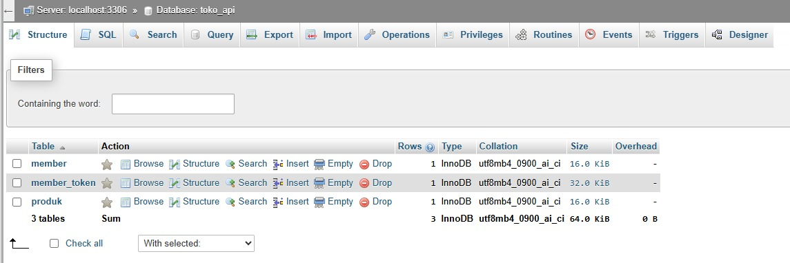

### 3. Instalasi CodeIgniter 4 sebagai RESTful API

Backend dibuat menggunakan framework CodeIgniter 4 dan diinstal melalui Composer. Project backend diberi nama `toko-api` dan disimpan pada folder `backend/toko-api` di dalam repository praktikum. Versi CodeIgniter yang digunakan adalah 4.7.6.

Server pengembangan CodeIgniter dijalankan menggunakan perintah `php spark serve` pada alamat lokal `127.0.0.1` dengan port `8080`. Dengan pengaturan tersebut, API dapat diuji melalui Postman menggunakan alamat `http://127.0.0.1:8080`.

### 4. Menghubungkan CodeIgniter dengan Database dan Membuat Response JSON

Konfigurasi koneksi database dilakukan pada file `backend/toko-api/app/Config/Database.php`. Konfigurasi diarahkan ke MySQL Laragon dengan hostname `localhost`, username `root`, database `toko_api`, driver `MySQLi`, dan port `3306`.

Koneksi diuji menggunakan perintah `php spark db:table --show`. Hasil pemeriksaan menunjukkan bahwa CodeIgniter berhasil terhubung ke database `toko_api` dan dapat membaca tabel `member`, `member_token`, serta `produk`.

Selanjutnya dibuat file `RestfulController.php` pada folder `app/Controllers`. Controller ini menggunakan `CodeIgniter\RESTful\ResourceController` dan format response JSON. Fungsi `responseHasil()` digunakan untuk mengirim response yang memuat tiga bagian, yaitu `code`, `status`, dan `data`.

**Hasil Pemeriksaan Koneksi Database**

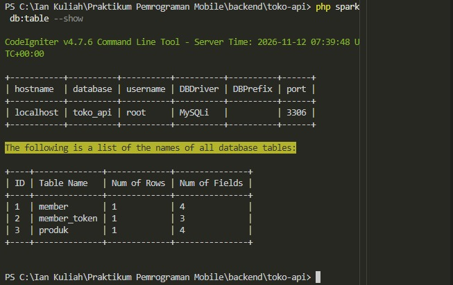

### 5. Membuat API Registrasi

Fitur registrasi digunakan untuk menyimpan data anggota ke tabel `member`. Implementasi backend dibuat melalui model, controller, dan route sebagai berikut:

- `app/Models/MRegistrasi.php`: menggunakan tabel `member` dan mengizinkan pengisian kolom `nama`, `email`, serta `password`.
- `app/Controllers/RegistrasiController.php`: menerima data nama, email, dan password. Password diproses menggunakan fungsi `password_hash()` sebelum disimpan ke database.
- `app/Config/Routes.php`: menambahkan endpoint `POST /registrasi` yang diarahkan ke fungsi `registrasi()` pada `RegistrasiController`.

Pengujian dilakukan menggunakan Postman dengan metode `POST`, alamat `http://127.0.0.1:8080/registrasi`, serta Body berformat raw JSON. Hasil pengujian menunjukkan response dengan kode `200`, status `true`, dan data **Registrasi Berhasil**. Data anggota juga berhasil tersimpan pada tabel `member` di phpMyAdmin.

**Pengujian API Registrasi**

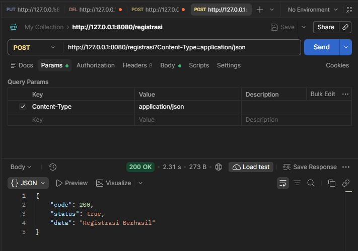

**Data Anggota pada Tabel Member**

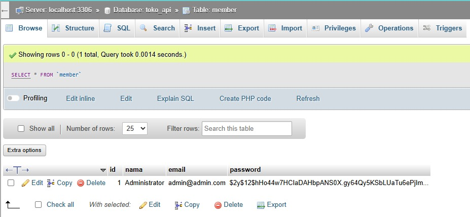

### 6. Membuat API Login

Fitur login digunakan untuk memeriksa email dan password anggota yang telah terdaftar. Implementasi backend terdiri atas beberapa file berikut:

- `app/Models/MMember.php`: menggunakan tabel `member` untuk mengambil data anggota berdasarkan email.
- `app/Models/MLogin.php`: menggunakan tabel `member_token` dan mengizinkan pengisian kolom `member_id` serta `auth_key`.
- `app/Controllers/LoginController.php`: memeriksa keberadaan email, memverifikasi password menggunakan `password_verify()`, membuat token autentikasi, dan mengembalikan informasi pengguna.
- `app/Config/Routes.php`: menambahkan endpoint `POST /login` yang diarahkan ke fungsi `login()` pada `LoginController`.

Pengujian dilakukan melalui Postman menggunakan metode `POST` ke alamat `http://127.0.0.1:8080/login` dengan Body raw JSON yang berisi email dan password. Login berhasil menghasilkan response dengan kode `200`, status `true`, token autentikasi, serta informasi ID dan email pengguna. Token login disimpan pada tabel `member_token`.

**Pengujian API Login**

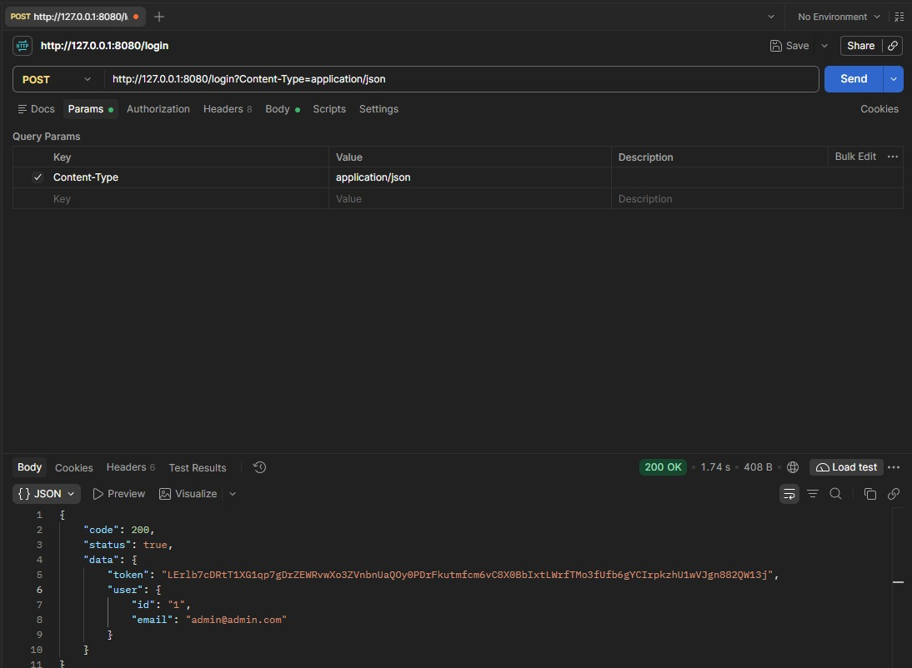

**Data Token pada Tabel Member Token**

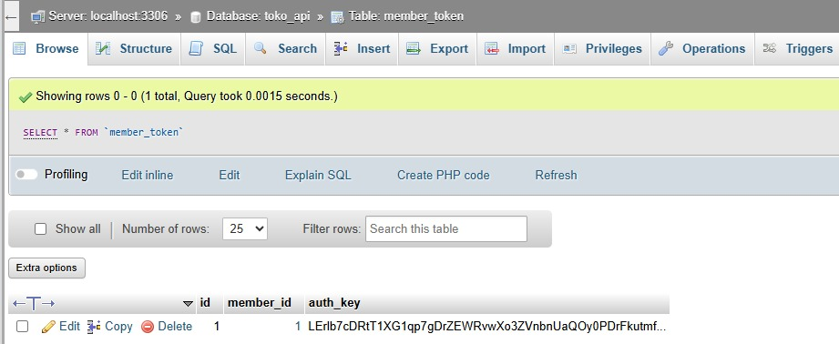

### 7. Membuat API CRUD Produk

Fitur CRUD Produk digunakan untuk mengelola data produk pada tabel `produk`. Implementasi backend dibuat menggunakan model `MProduk.php` dan controller `ProdukController.php`.

Model `MProduk` menggunakan tabel `produk`, primary key `id`, serta mengizinkan pengisian kolom `kode_produk`, `nama_produk`, dan `harga`. Controller `ProdukController` memiliki lima fungsi utama, yaitu:

- `create()`: menambahkan data produk.
- `list()`: menampilkan seluruh data produk.
- `detail($id)`: menampilkan detail produk berdasarkan ID.
- `ubah($id)`: memperbarui data produk berdasarkan ID.
- `hapus($id)`: menghapus data produk berdasarkan ID.

Route CRUD Produk ditambahkan pada `app/Config/Routes.php` menggunakan kelompok route `produk`, dengan pengaturan metode HTTP sebagai berikut:

| Method | Endpoint | Fungsi |
|---|---|---|
| POST | `/produk` | Menambahkan produk |
| GET | `/produk` | Menampilkan seluruh produk |
| GET | `/produk/{id}` | Menampilkan detail produk |
| PUT | `/produk/{id}` | Mengubah produk |
| DELETE | `/produk/{id}` | Menghapus produk |

Seluruh endpoint diuji menggunakan Postman. Pengujian meliputi penambahan produk, penampilan daftar produk, penampilan detail produk berdasarkan ID, perubahan data produk, dan penghapusan produk. Setiap pengujian berhasil memberikan response sesuai fungsi endpoint.

**Pengujian Create Produk**

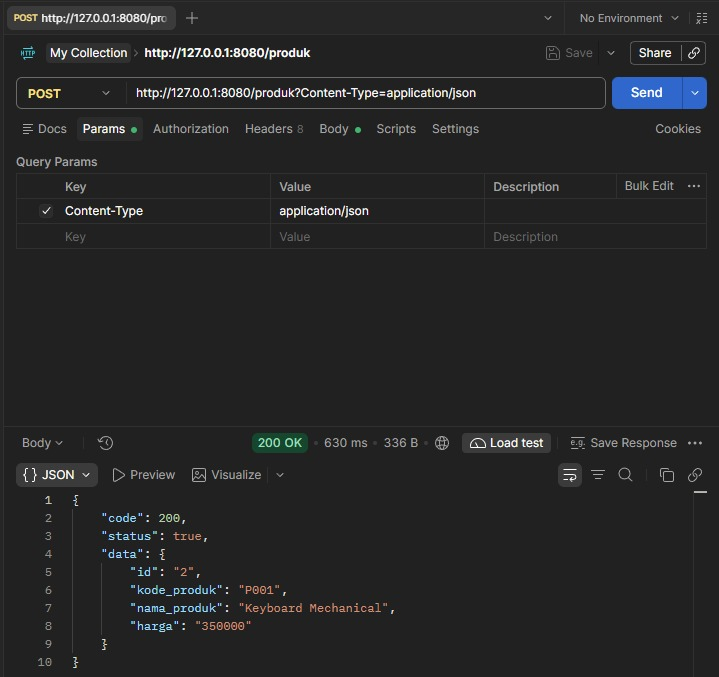

**Pengujian List Produk**

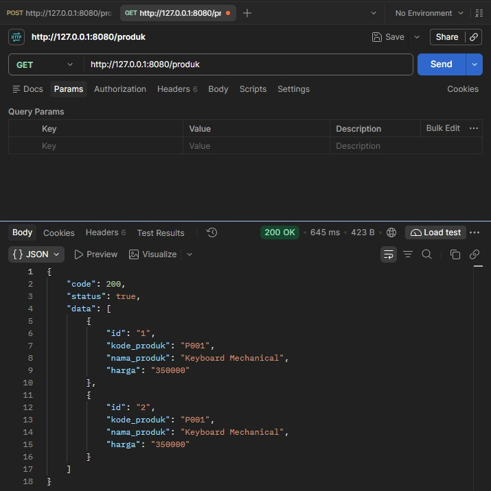

**Pengujian Detail Produk**

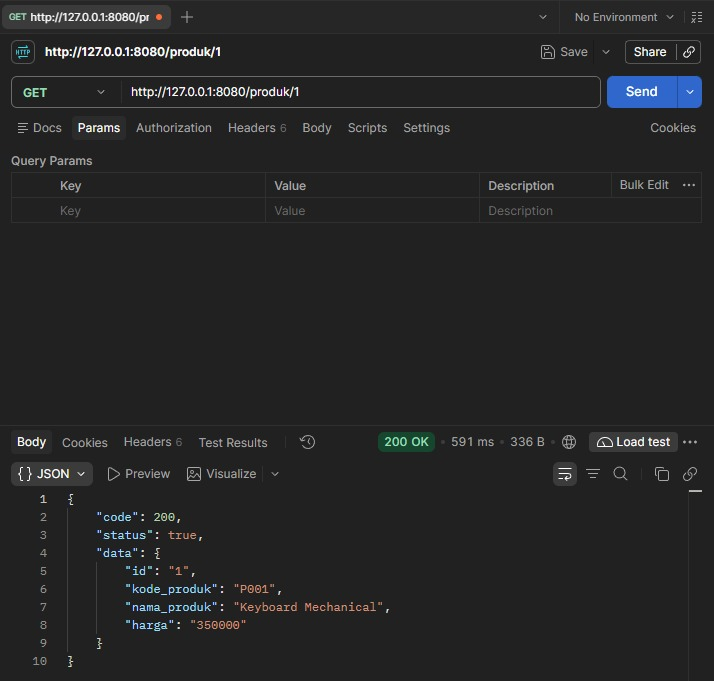

**Pengujian Update Produk**

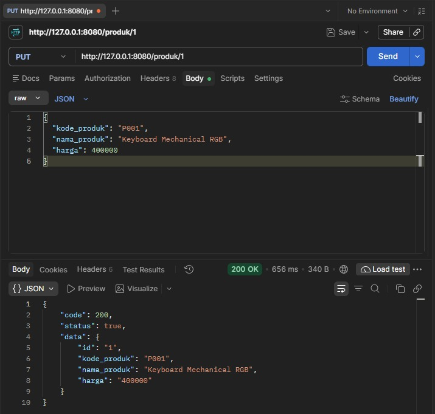

**Pengujian Delete Produk**

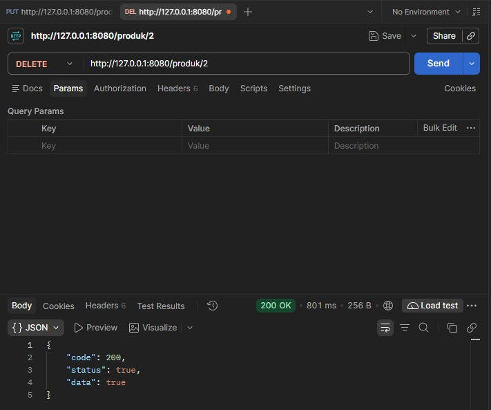

### 8. Membuat Model pada Flutter

Pada project Flutter `tokokita`, dibuat folder `lib/model` untuk memisahkan struktur data dari tampilan aplikasi. Model yang dibuat terdiri atas:

- `login.dart`: menampung data response login, yaitu kode response, status, token, ID pengguna, dan email pengguna. Data dibaca melalui fungsi `Login.fromJson()`.
- `registrasi.dart`: menampung kode response, status, dan data hasil registrasi melalui fungsi `Registrasi.fromJson()`.
- `produk.dart`: menampung ID, kode produk, nama produk, dan harga produk melalui fungsi `Produk.fromJson()`.

Pemisahan model ini digunakan agar data yang diterima dari API dapat direpresentasikan dalam bentuk objek Dart.

### 9. Membuat Halaman Registrasi dan Login

Halaman antarmuka dibuat pada folder `tokokita/lib/ui`.

Halaman Registrasi dibuat pada file `registrasi_page.dart` menggunakan `StatefulWidget` dan `Form`. Form terdiri atas empat masukan, yaitu Nama, Email, Password, dan Konfirmasi Password. Validasi digunakan untuk memeriksa panjang nama, format email, panjang password minimal enam karakter, serta kesesuaian konfirmasi password.

Halaman Login dibuat pada file `login_page.dart`. Halaman ini menyediakan masukan Email dan Password, tombol Login, serta tautan **Registrasi** yang digunakan untuk membuka halaman registrasi melalui `Navigator.push()`.

Tema aplikasi disesuaikan menggunakan Material 2 agar tampilan AppBar, latar halaman, dan tombol menyerupai contoh pada modul.

**Tampilan Halaman Registrasi**

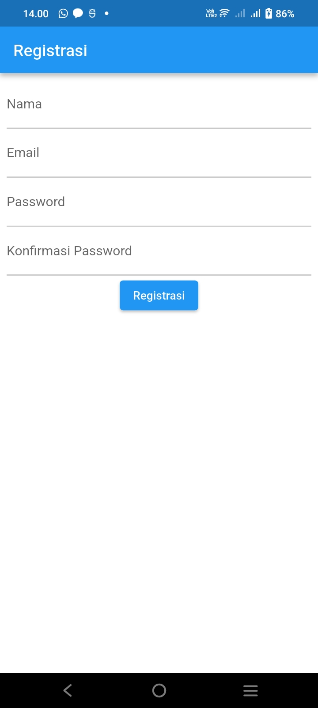

**Tampilan Halaman Login**

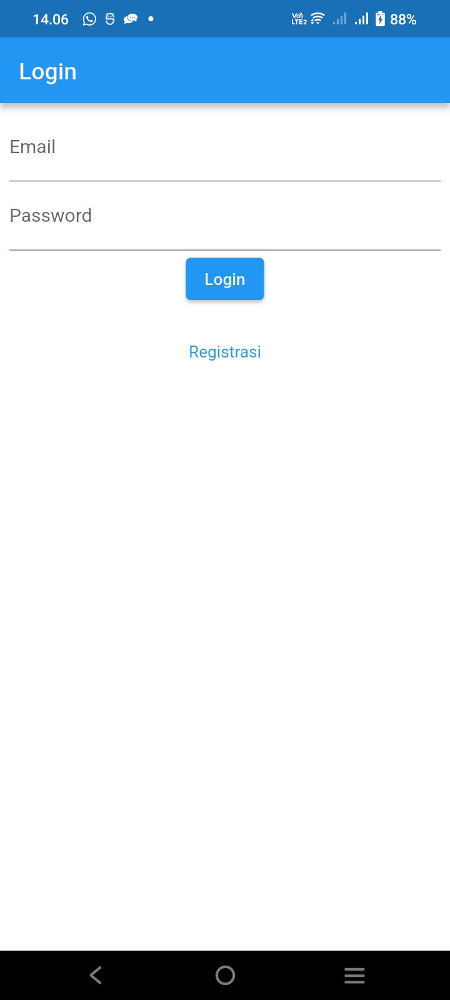

### 10. Membuat Form Produk, Detail Produk, dan List Produk

Form Produk dibuat pada file `produk_form.dart` menggunakan `StatefulWidget`, `Form`, dan `TextEditingController`. Form memiliki tiga masukan, yaitu Kode Produk, Nama Produk, dan Harga. Form dapat digunakan untuk kondisi tambah maupun ubah produk. Ketika objek produk diberikan ke form, judul berubah menjadi **UBAH PRODUK** dan nilai setiap masukan diisi berdasarkan data produk tersebut.

Halaman Detail Produk dibuat pada file `produk_detail.dart`. Halaman ini menampilkan kode, nama, dan harga produk, serta menyediakan tombol **EDIT** dan **DELETE**. Tombol EDIT membuka Form Produk dengan data produk yang dipilih. Tombol DELETE menampilkan dialog konfirmasi.

Halaman daftar produk dibuat pada file `produk_page.dart` menggunakan `ListView`, `Card`, dan `ListTile`. Pada tahap antarmuka ini ditampilkan tiga data contoh, yaitu Kamera, Kulkas, dan Mesin Cuci. Ikon tambah digunakan untuk membuka Form Produk, sedangkan pemilihan salah satu produk membuka halaman Detail Produk.

**Tampilan List Produk**

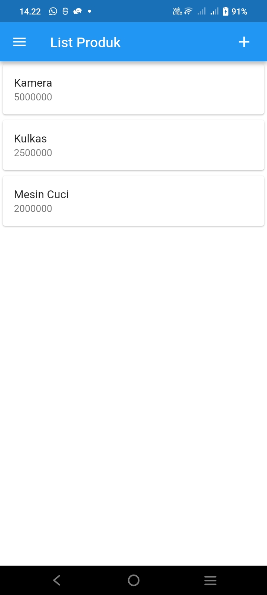

**Tampilan Form Tambah Produk**

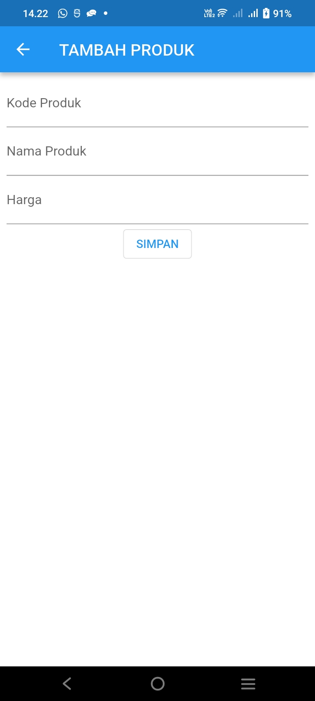

**Tampilan Detail Produk**

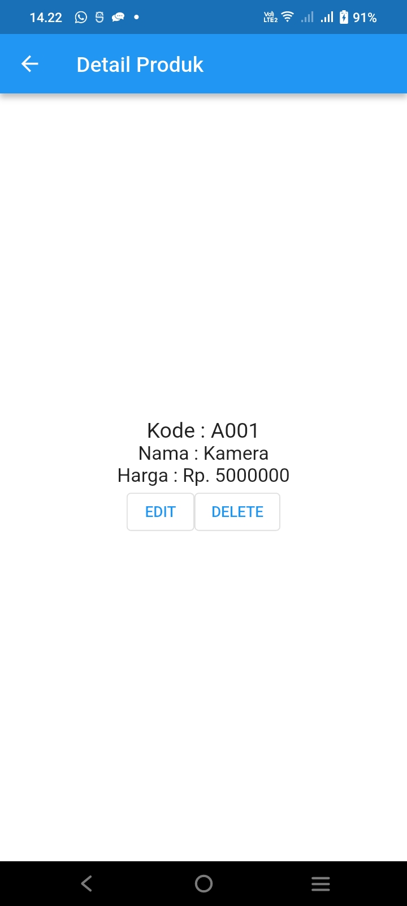

**Tampilan Form Ubah Produk**

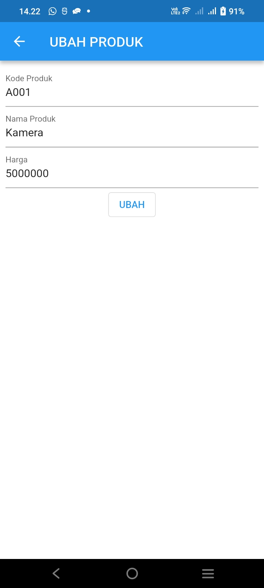

### Kesimpulan Praktikum

Pada Pertemuan 8, praktikum Modul 4 memberikan pemahaman mengenai pembuatan RESTful API menggunakan CodeIgniter 4 dan pengembangan antarmuka aplikasi menggunakan Flutter. Materi yang dipraktikkan meliputi pembuatan database `toko_api`, konfigurasi koneksi database, pembuatan response JSON, API registrasi dan login, serta API CRUD Produk yang diuji menggunakan Postman.

Pada sisi Flutter, praktikum meliputi pembuatan project `tokokita`, model Login, Registrasi, dan Produk, serta halaman Registrasi, Login, Form Produk, Detail Produk, dan List Produk. Pada tahap ini, API backend telah diuji melalui Postman, sedangkan tampilan Flutter masih menggunakan data contoh dan validasi form. Sesuai materi pada akhir modul, penampilan data produk dari REST API serta proses simpan dan ubah produk dari Flutter akan dikembangkan pada materi selanjutnya.

---
