# Laporan Praktikum Pemrograman Mobile

**Nama** : Ian Jullian Sutrisno<br>
**NIM** : H1D024039<br>
**Shift** : Awal I / Akhir C<br>
**Praktikum** : Pemrograman Mobile

---

## 📝 Tugas Pertemuan 8

**Tanggal**: Selasa, 10 November 2026

**Modul**: Modul 4 — Operasi CRUD dengan API CodeIgniter 4

### 1. Membuat Project Flutter Toko Kita

Pada bagian ini, project aplikasi dibuat menggunakan framework Flutter dengan bahasa pemrograman Dart. Project diberi nama `tokokita` dan disimpan di dalam folder `Praktikum Pemrograman Mobile`, sejajar dengan project `router_flutter` dari praktikum sebelumnya. Project `tokokita` digunakan untuk membuat antarmuka aplikasi Toko Kita yang terdiri atas halaman registrasi, login, form produk, detail produk, dan daftar produk.

File utama aplikasi berada pada `tokokita/lib/main.dart`, sedangkan kode halaman dikelompokkan ke dalam folder `tokokita/lib/ui` dan model data dikelompokkan ke dalam folder `tokokita/lib/model`.

### 2. Membuat Database Toko API

Database dibuat menggunakan MySQL melalui phpMyAdmin yang dijalankan dengan Laragon. Database diberi nama `toko_api` dan digunakan untuk menyimpan data anggota, token login, serta produk.

Di dalam database `toko_api` dibuat tiga tabel, yaitu:

- `member`: menyimpan data anggota yang terdiri atas `id`, `nama`, `email`, dan `password`.
- `member_token`: menyimpan token autentikasi yang terdiri atas `id`, `member_id`, dan `auth_key`. Kolom `member_id` memiliki relasi dengan tabel `member`.
- `produk`: menyimpan data produk yang terdiri atas `id`, `kode_produk`, `nama_produk`, dan `harga`.

**Database dan Tabel Toko API**

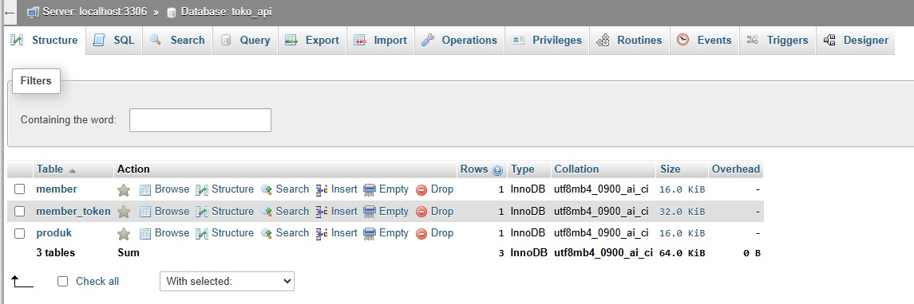

### 3. Instalasi CodeIgniter 4 sebagai RESTful API

Backend dibuat menggunakan framework CodeIgniter 4 dan diinstal melalui Composer. Project backend diberi nama `toko-api` dan disimpan pada folder `backend/toko-api` di dalam repository praktikum. Versi CodeIgniter yang digunakan adalah 4.7.6.

Server pengembangan CodeIgniter dijalankan menggunakan perintah `php spark serve` pada alamat lokal `127.0.0.1` dengan port `8080`. Dengan pengaturan tersebut, API dapat diuji melalui Postman menggunakan alamat `http://127.0.0.1:8080`.

### 4. Menghubungkan CodeIgniter dengan Database dan Membuat Response JSON

Konfigurasi koneksi database dilakukan pada file `backend/toko-api/app/Config/Database.php`. Konfigurasi diarahkan ke MySQL Laragon dengan hostname `localhost`, username `root`, database `toko_api`, driver `MySQLi`, dan port `3306`.

Koneksi diuji menggunakan perintah `php spark db:table --show`. Hasil pemeriksaan menunjukkan bahwa CodeIgniter berhasil terhubung ke database `toko_api` dan dapat membaca tabel `member`, `member_token`, serta `produk`.

Selanjutnya dibuat file `RestfulController.php` pada folder `app/Controllers`. Controller ini menggunakan `CodeIgniter\RESTful\ResourceController` dan format response JSON. Fungsi `responseHasil()` digunakan untuk mengirim response yang memuat tiga bagian, yaitu `code`, `status`, dan `data`.

**Hasil Pemeriksaan Koneksi Database**

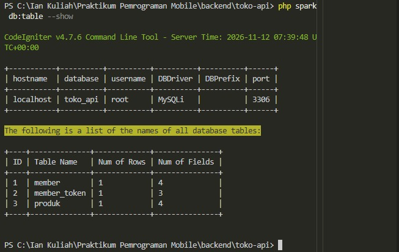

### 5. Membuat API Registrasi

Fitur registrasi digunakan untuk menyimpan data anggota ke tabel `member`. Implementasi backend dibuat melalui model, controller, dan route sebagai berikut:

- `app/Models/MRegistrasi.php`: menggunakan tabel `member` dan mengizinkan pengisian kolom `nama`, `email`, serta `password`.
- `app/Controllers/RegistrasiController.php`: menerima data nama, email, dan password. Password diproses menggunakan fungsi `password_hash()` sebelum disimpan ke database.
- `app/Config/Routes.php`: menambahkan endpoint `POST /registrasi` yang diarahkan ke fungsi `registrasi()` pada `RegistrasiController`.

Pengujian dilakukan menggunakan Postman dengan metode `POST`, alamat `http://127.0.0.1:8080/registrasi`, serta Body berformat raw JSON. Hasil pengujian menunjukkan response dengan kode `200`, status `true`, dan data **Registrasi Berhasil**. Data anggota juga berhasil tersimpan pada tabel `member` di phpMyAdmin.

**Pengujian API Registrasi**

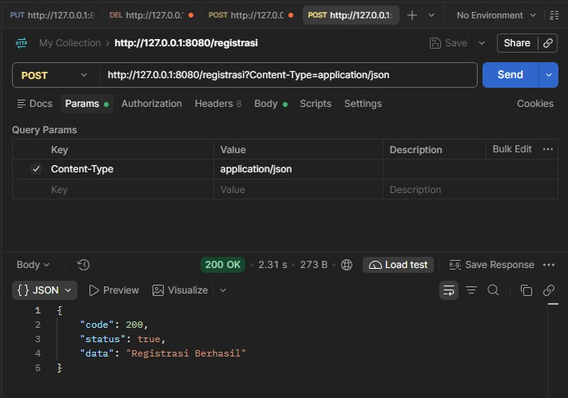

**Data Anggota pada Tabel Member**

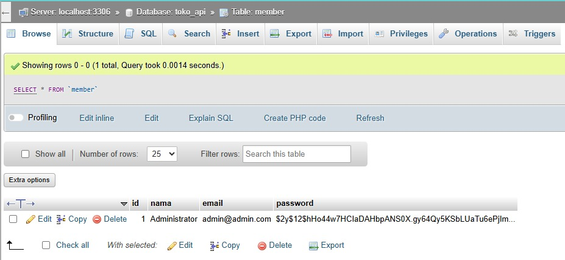

### 6. Membuat API Login

Fitur login digunakan untuk memeriksa email dan password anggota yang telah terdaftar. Implementasi backend terdiri atas beberapa file berikut:

- `app/Models/MMember.php`: menggunakan tabel `member` untuk mengambil data anggota berdasarkan email.
- `app/Models/MLogin.php`: menggunakan tabel `member_token` dan mengizinkan pengisian kolom `member_id` serta `auth_key`.
- `app/Controllers/LoginController.php`: memeriksa keberadaan email, memverifikasi password menggunakan `password_verify()`, membuat token autentikasi, dan mengembalikan informasi pengguna.
- `app/Config/Routes.php`: menambahkan endpoint `POST /login` yang diarahkan ke fungsi `login()` pada `LoginController`.

Pengujian dilakukan melalui Postman menggunakan metode `POST` ke alamat `http://127.0.0.1:8080/login` dengan Body raw JSON yang berisi email dan password. Login berhasil menghasilkan response dengan kode `200`, status `true`, token autentikasi, serta informasi ID dan email pengguna. Token login disimpan pada tabel `member_token`.

**Pengujian API Login**

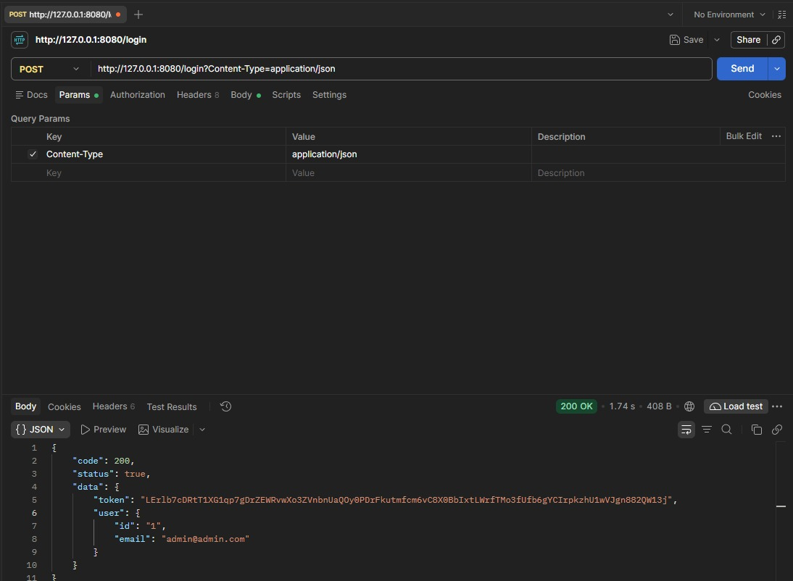

**Data Token pada Tabel Member Token**

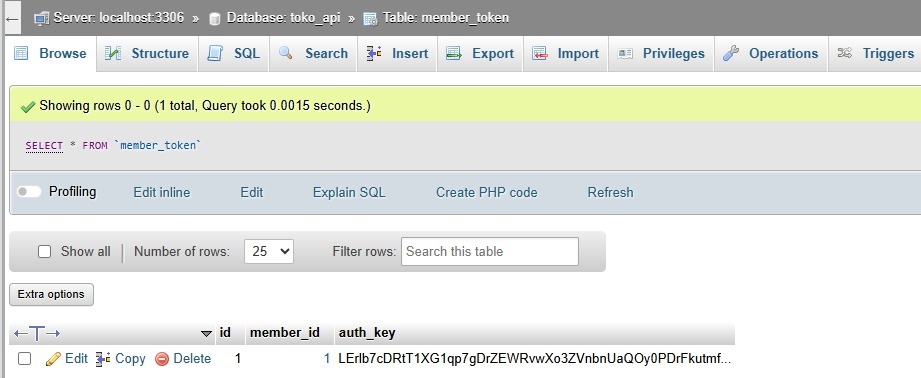

### 7. Membuat API CRUD Produk

Fitur CRUD Produk digunakan untuk mengelola data produk pada tabel `produk`. Implementasi backend dibuat menggunakan model `MProduk.php` dan controller `ProdukController.php`.

Model `MProduk` menggunakan tabel `produk`, primary key `id`, serta mengizinkan pengisian kolom `kode_produk`, `nama_produk`, dan `harga`. Controller `ProdukController` memiliki lima fungsi utama, yaitu:

- `create()`: menambahkan data produk.
- `list()`: menampilkan seluruh data produk.
- `detail($id)`: menampilkan detail produk berdasarkan ID.
- `ubah($id)`: memperbarui data produk berdasarkan ID.
- `hapus($id)`: menghapus data produk berdasarkan ID.

Route CRUD Produk ditambahkan pada `app/Config/Routes.php` menggunakan kelompok route `produk`, dengan pengaturan metode HTTP sebagai berikut:

| Method | Endpoint | Fungsi |
|---|---|---|
| POST | `/produk` | Menambahkan produk |
| GET | `/produk` | Menampilkan seluruh produk |
| GET | `/produk/{id}` | Menampilkan detail produk |
| PUT | `/produk/{id}` | Mengubah produk |
| DELETE | `/produk/{id}` | Menghapus produk |

Seluruh endpoint diuji menggunakan Postman. Pengujian meliputi penambahan produk, penampilan daftar produk, penampilan detail produk berdasarkan ID, perubahan data produk, dan penghapusan produk. Setiap pengujian berhasil memberikan response sesuai fungsi endpoint.

**Pengujian Create Produk**

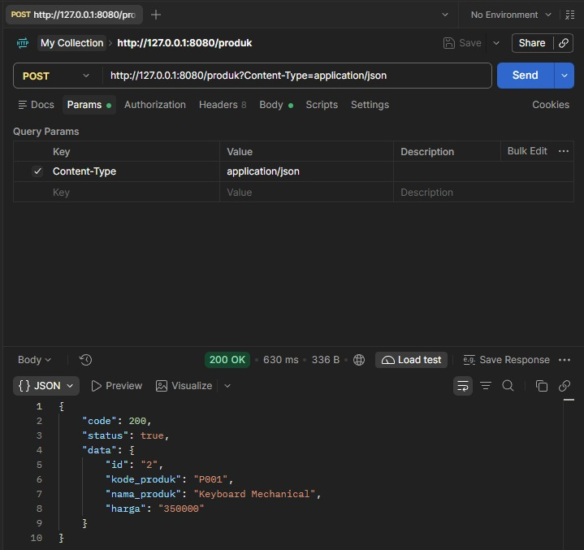

**Pengujian List Produk**

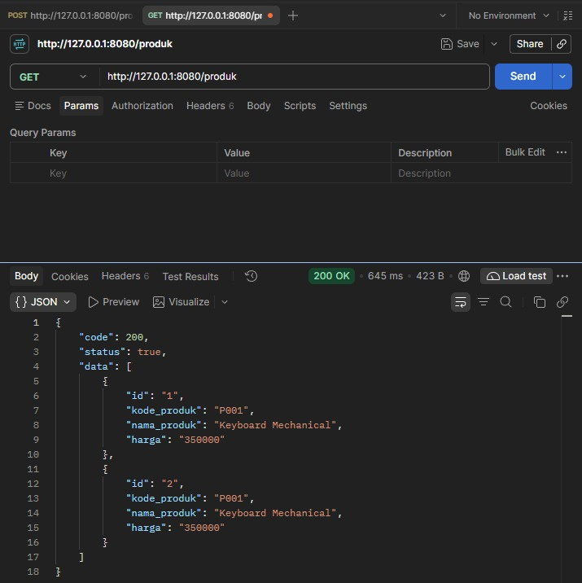

**Pengujian Detail Produk**

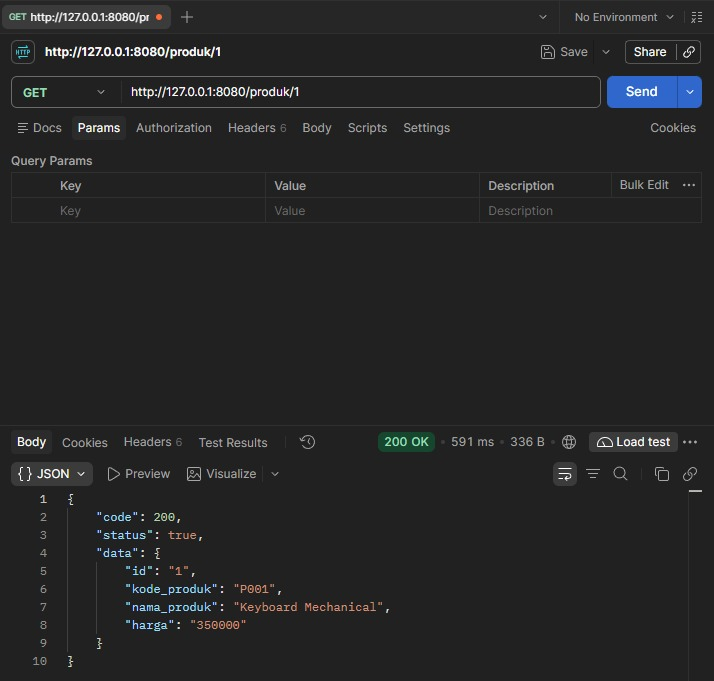

**Pengujian Update Produk**

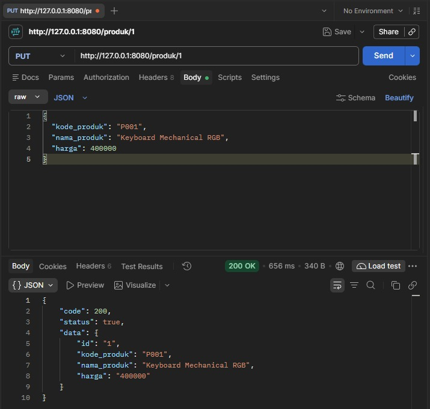

**Pengujian Delete Produk**

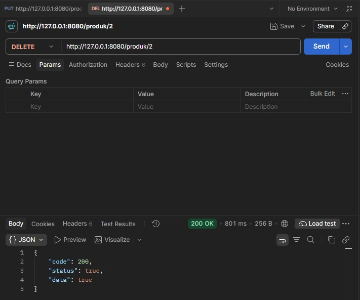

### 8. Membuat Model pada Flutter

Pada project Flutter `tokokita`, dibuat folder `lib/model` untuk memisahkan struktur data dari tampilan aplikasi. Model yang dibuat terdiri atas:

- `login.dart`: menampung data response login, yaitu kode response, status, token, ID pengguna, dan email pengguna. Data dibaca melalui fungsi `Login.fromJson()`.
- `registrasi.dart`: menampung kode response, status, dan data hasil registrasi melalui fungsi `Registrasi.fromJson()`.
- `produk.dart`: menampung ID, kode produk, nama produk, dan harga produk melalui fungsi `Produk.fromJson()`.

Pemisahan model ini digunakan agar data yang diterima dari API dapat direpresentasikan dalam bentuk objek Dart.

### 9. Membuat Halaman Registrasi dan Login

Halaman antarmuka dibuat pada folder `tokokita/lib/ui`.

Halaman Registrasi dibuat pada file `registrasi_page.dart` menggunakan `StatefulWidget` dan `Form`. Form terdiri atas empat masukan, yaitu Nama, Email, Password, dan Konfirmasi Password. Validasi digunakan untuk memeriksa panjang nama, format email, panjang password minimal enam karakter, serta kesesuaian konfirmasi password.

Halaman Login dibuat pada file `login_page.dart`. Halaman ini menyediakan masukan Email dan Password, tombol Login, serta tautan **Registrasi** yang digunakan untuk membuka halaman registrasi melalui `Navigator.push()`.

Tema aplikasi disesuaikan menggunakan Material 2 agar tampilan AppBar, latar halaman, dan tombol menyerupai contoh pada modul.

**Tampilan Halaman Registrasi**

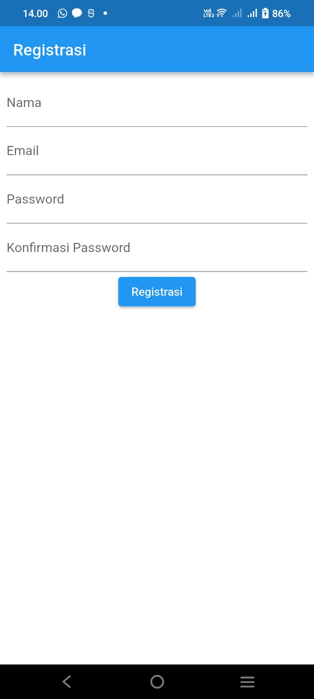

**Tampilan Halaman Login**

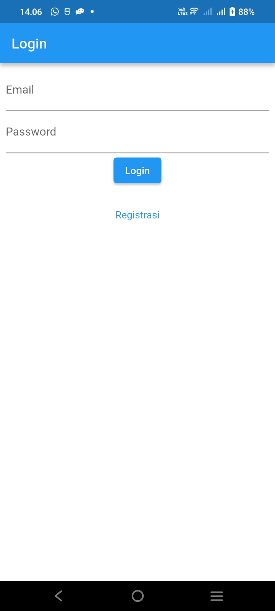

### 10. Membuat Form Produk, Detail Produk, dan List Produk

Form Produk dibuat pada file `produk_form.dart` menggunakan `StatefulWidget`, `Form`, dan `TextEditingController`. Form memiliki tiga masukan, yaitu Kode Produk, Nama Produk, dan Harga. Form dapat digunakan untuk kondisi tambah maupun ubah produk. Ketika objek produk diberikan ke form, judul berubah menjadi **UBAH PRODUK** dan nilai setiap masukan diisi berdasarkan data produk tersebut.

Halaman Detail Produk dibuat pada file `produk_detail.dart`. Halaman ini menampilkan kode, nama, dan harga produk, serta menyediakan tombol **EDIT** dan **DELETE**. Tombol EDIT membuka Form Produk dengan data produk yang dipilih. Tombol DELETE menampilkan dialog konfirmasi.

Halaman daftar produk dibuat pada file `produk_page.dart` menggunakan `ListView`, `Card`, dan `ListTile`. Pada tahap antarmuka ini ditampilkan tiga data contoh, yaitu Kamera, Kulkas, dan Mesin Cuci. Ikon tambah digunakan untuk membuka Form Produk, sedangkan pemilihan salah satu produk membuka halaman Detail Produk.

**Tampilan List Produk**

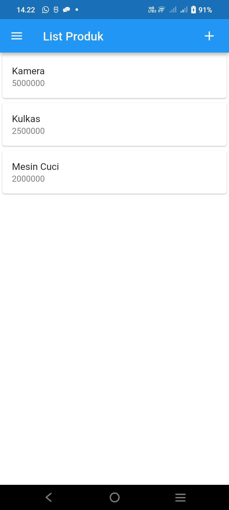

**Tampilan Form Tambah Produk**

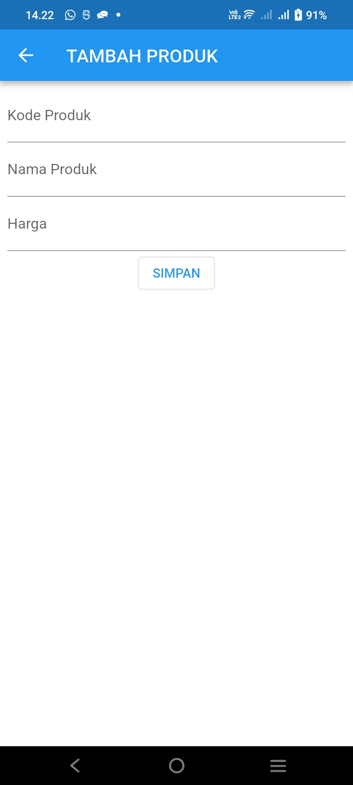

**Tampilan Detail Produk**

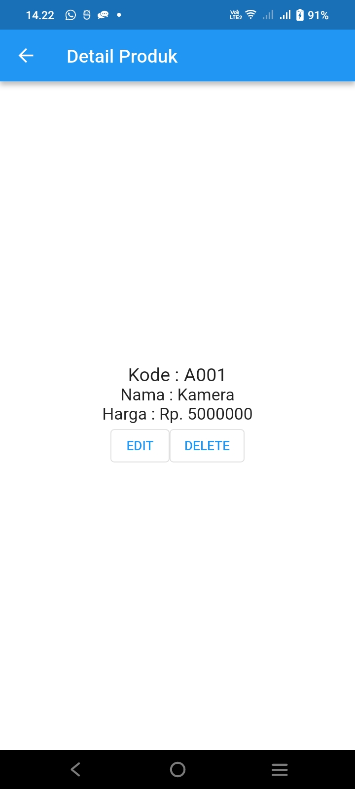

**Tampilan Form Ubah Produk**

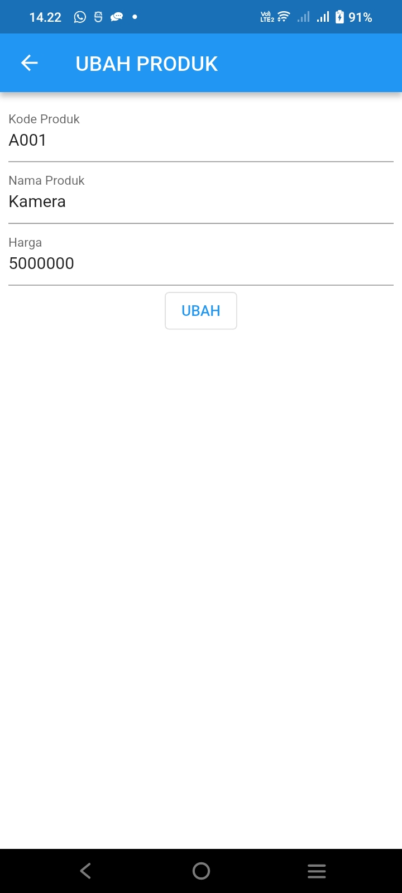

### Kesimpulan Praktikum

Pada Pertemuan 8, praktikum Modul 4 memberikan pemahaman mengenai pembuatan RESTful API menggunakan CodeIgniter 4 dan pengembangan antarmuka aplikasi menggunakan Flutter. Materi yang dipraktikkan meliputi pembuatan database `toko_api`, konfigurasi koneksi database, pembuatan response JSON, API registrasi dan login, serta API CRUD Produk yang diuji menggunakan Postman.

Pada sisi Flutter, praktikum meliputi pembuatan project `tokokita`, model Login, Registrasi, dan Produk, serta halaman Registrasi, Login, Form Produk, Detail Produk, dan List Produk. Pada tahap ini, API backend telah diuji melalui Postman, sedangkan tampilan Flutter masih menggunakan data contoh dan validasi form. Sesuai materi pada akhir modul, penampilan data produk dari REST API serta proses simpan dan ubah produk dari Flutter akan dikembangkan pada materi selanjutnya.

---

## 📝 Tugas Pertemuan 9

**Tanggal**: Selasa, 17 November 2026

**Modul**: Modul 5 — Integrasi Flutter dengan REST API CodeIgniter 4

### 1. Mengintegrasikan Flutter dengan REST API

Pada Modul 5, project Flutter `tokokita` yang telah dibuat pada praktikum sebelumnya dikembangkan agar dapat terhubung dengan REST API menggunakan backend CodeIgniter 4. Pada tahap sebelumnya, halaman Flutter masih menggunakan data contoh dan belum sepenuhnya terhubung dengan database.

Pada modul ini, dilakukan integrasi antara antarmuka Flutter dengan REST API sehingga proses registrasi, login, serta pengelolaan data produk dapat dilakukan secara langsung melalui aplikasi.

Integrasi dilakukan dengan memanfaatkan package HTTP untuk mengirimkan request ke backend dan menerima response dalam format JSON.

### 2. Membuat Konfigurasi API pada Flutter

Untuk mempermudah pengelolaan alamat REST API, dibuat file `api_url.dart` pada folder `lib/helpers`.

File ini digunakan untuk menyimpan alamat dasar backend dan endpoint yang digunakan aplikasi.

Beberapa endpoint yang dikonfigurasi meliputi:

| Endpoint | Kegunaan |
|---|---|
| `/registrasi` | Registrasi pengguna |
| `/login` | Login pengguna |
| `/produk` | Menampilkan dan menambahkan produk |
| `/produk/{id}` | Menampilkan detail, mengubah, dan menghapus produk |

Selain itu, dibuat file `api.dart` yang berfungsi menangani komunikasi HTTP menggunakan metode GET, POST, PUT, dan DELETE.

Pada file tersebut juga ditambahkan pengiriman token autentikasi menggunakan header Authorization dengan format Bearer Token. Token diambil dari penyimpanan lokal melalui `UserInfo`.

### 3. Membuat Bloc untuk Mengelola Proses API

Pada folder `lib/bloc` dibuat beberapa file yang berfungsi sebagai penghubung antara halaman Flutter dengan REST API.

File-file yang dibuat meliputi:

- `registrasi_bloc.dart`: mengirimkan data nama, email, dan password ke endpoint registrasi, kemudian membaca response dari backend.
- `login_bloc.dart`: mengirimkan email dan password ke endpoint login dan menerima token autentikasi serta informasi pengguna.
- `logout_bloc.dart`: menghapus data autentikasi pengguna melalui `UserInfo` ketika pengguna melakukan logout.
- `produk_bloc.dart`: menangani operasi pengambilan, penambahan, pengubahan, dan penghapusan data produk.

Pemisahan fungsi ke dalam Bloc bertujuan agar kode pada halaman antarmuka lebih terstruktur dan proses komunikasi dengan API tidak dilakukan secara langsung di dalam komponen tampilan.

### 4. Membuat Common Dialog Widget

Untuk memberikan informasi kepada pengguna mengenai hasil suatu proses, dibuat dua widget dialog pada folder `lib/widget`.

File yang dibuat yaitu:

- `success_dialog.dart`: digunakan untuk menampilkan pesan ketika proses berhasil, seperti registrasi pengguna.
- `warning_dialog.dart`: digunakan untuk menampilkan pesan ketika suatu proses mengalami kegagalan.

Kedua dialog dilengkapi dengan tombol OK untuk menutup pesan yang ditampilkan. Penggunaan widget ini membantu memberikan informasi yang lebih jelas ketika pengguna melakukan aktivitas di dalam aplikasi.

### 5. Mengatur Halaman Awal Berdasarkan Status Login

File `main.dart` dimodifikasi agar aplikasi dapat memeriksa status autentikasi pengguna ketika pertama kali dijalankan.

Pemeriksaan dilakukan dengan mengambil token yang tersimpan melalui `UserInfo`.

Alur yang diterapkan adalah sebagai berikut:

1. Ketika aplikasi dibuka, sistem memeriksa token autentikasi yang tersimpan.
2. Apabila token tersedia, pengguna langsung diarahkan ke halaman daftar produk (`ProdukPage`).
3. Apabila token tidak tersedia, aplikasi menampilkan halaman login (`LoginPage`).
4. Selama pemeriksaan berlangsung, aplikasi menampilkan indikator loading.

Dengan mekanisme tersebut, pengguna yang telah berhasil login tidak harus melakukan login kembali setiap kali aplikasi dibuka selama token masih tersedia.

### 6. Mengintegrasikan Halaman Registrasi dengan REST API

Halaman registrasi pada file `registrasi_page.dart` dimodifikasi agar dapat mengirimkan data pengguna secara langsung ke backend CodeIgniter.

Form registrasi terdiri atas empat masukan, yaitu nama, email, password, dan konfirmasi password.

Sebelum data dikirim, dilakukan validasi untuk memastikan seluruh masukan telah sesuai dengan ketentuan.

Ketika tombol Registrasi ditekan, aplikasi menjalankan fungsi `_submit()` yang memanggil `RegistrasiBloc.registrasi()`.

Apabila proses registrasi berhasil, aplikasi menampilkan `SuccessDialog` dengan pesan bahwa registrasi berhasil dan pengguna dapat melakukan login. Apabila terjadi kegagalan, aplikasi menampilkan `WarningDialog`.

Data pengguna yang berhasil didaftarkan akan tersimpan pada tabel `member` di database `toko_api`.

### 7. Mengintegrasikan Halaman Login dengan REST API

Halaman login pada file `login_page.dart` dimodifikasi agar dapat melakukan autentikasi menggunakan REST API.

Pengguna memasukkan email dan password yang telah didaftarkan sebelumnya. Ketika tombol Login ditekan, aplikasi memanggil fungsi `_submit()` yang menggunakan `LoginBloc.login()`.

Apabila autentikasi berhasil, aplikasi akan:

1. Menerima token autentikasi dari backend.
2. Menyimpan token menggunakan `UserInfo`.
3. Menyimpan ID pengguna.
4. Mengarahkan pengguna ke halaman daftar produk melalui `Navigator.pushReplacement()`.

Apabila autentikasi gagal, aplikasi menampilkan pesan peringatan melalui `WarningDialog`.

Token yang telah disimpan digunakan untuk mengakses endpoint API yang membutuhkan autentikasi.

### 8. Mengintegrasikan Halaman Daftar Produk dengan REST API

Halaman daftar produk pada file `produk_page.dart` dimodifikasi agar tidak lagi menggunakan data produk contoh yang ditulis secara langsung di dalam kode Flutter.

Pengambilan data dilakukan menggunakan fungsi `ProdukBloc.getProduks()` yang terhubung dengan endpoint GET `/produk`.

Untuk menampilkan data digunakan widget `FutureBuilder` dan `ListView.builder`.

Setiap produk ditampilkan dalam bentuk Card yang memuat:

- Nama produk.
- Kode produk.
- Harga produk.

Selain itu, ditambahkan beberapa fungsi pendukung, yaitu:

- Indikator loading ketika aplikasi sedang mengambil data produk.
- Pesan apabila database belum memiliki data produk.
- Tombol untuk mencoba kembali ketika pengambilan data mengalami kegagalan.
- Tombol tambah produk untuk membuka halaman form.
- Tombol refresh untuk memperbarui daftar produk.
- Menu logout untuk menghapus sesi autentikasi dan kembali ke halaman login.

Dengan perubahan tersebut, data yang ditampilkan pada halaman daftar produk berasal langsung dari database melalui REST API.

### 9. Mengintegrasikan Form Tambah dan Ubah Produk

File `produk_form.dart` dimodifikasi agar dapat digunakan untuk melakukan penambahan maupun perubahan data produk.

Form terdiri atas tiga masukan, yaitu:

- Kode Produk.
- Nama Produk.
- Harga.

Validasi digunakan untuk memastikan kode dan nama produk telah diisi serta harga berupa angka yang lebih dari nol.

Form mendukung dua kondisi penggunaan:

**a. Tambah Produk (Create)**

Apabila form dibuka tanpa membawa objek produk, aplikasi menampilkan judul TAMBAH PRODUK dan tombol SIMPAN.

Ketika tombol SIMPAN ditekan, data yang dimasukkan akan dikirim menggunakan fungsi `ProdukBloc.addProduk()` melalui metode HTTP POST ke endpoint `/produk`.

**b. Ubah Produk (Update)**

Apabila form dibuka dengan membawa objek produk, aplikasi menampilkan judul UBAH PRODUK dan tombol UBAH.

Nilai kode produk, nama produk, dan harga akan otomatis diisi berdasarkan data produk yang dipilih.

Ketika tombol UBAH ditekan, aplikasi memanggil `ProdukBloc.updateProduk()` menggunakan metode HTTP PUT ke endpoint `/produk/{id}`.

Setelah proses tambah atau ubah berhasil, halaman form ditutup dan halaman daftar produk memuat ulang data terbaru dari backend.

### 10. Mengintegrasikan Detail dan Hapus Produk

File `produk_detail.dart` dimodifikasi agar dapat menampilkan informasi produk berdasarkan data yang dipilih dari halaman daftar produk.

Informasi yang ditampilkan meliputi:

- Kode produk.
- Nama produk.
- Harga produk.

Pada halaman detail terdapat dua tombol utama, yaitu EDIT dan DELETE.

Tombol EDIT digunakan untuk membuka `ProdukForm` dengan membawa objek produk yang dipilih.

Sementara itu, tombol DELETE digunakan untuk menghapus data produk melalui REST API.

Sebelum proses penghapusan dilakukan, aplikasi menampilkan dialog konfirmasi yang menanyakan apakah pengguna yakin ingin menghapus produk tersebut.

Apabila pengguna menyetujui penghapusan, aplikasi menjalankan `ProdukBloc.deleteProduk()` menggunakan metode HTTP DELETE ke endpoint `/produk/{id}`.

Jika penghapusan berhasil, aplikasi kembali ke halaman daftar produk dan memuat ulang data. Apabila terjadi kegagalan, aplikasi menampilkan pesan melalui `WarningDialog`.

### 11. Mengonfigurasi Koneksi Backend dan Perangkat Android

Pada tahap pengujian, backend CodeIgniter dijalankan menggunakan Ubuntu melalui Windows Subsystem for Linux (WSL 2). Lingkungan Ubuntu digunakan untuk menjalankan PHP dan Composer karena executable PHP pada instalasi Laragon Windows mengalami pemblokiran oleh kebijakan Smart App Control.

Backend CodeIgniter dijalankan menggunakan perintah:

```bash
php spark serve --host 0.0.0.0 --port 8080
```

Database MySQL tetap menggunakan Laragon pada Windows. Koneksi dari Ubuntu ke MySQL dilakukan menggunakan gateway WSL dengan hostname `192.168.64.1` dan port `3306`.

Konfigurasi database disimpan pada file `.env` menggunakan akun MySQL khusus aplikasi. File `.env` tidak dimasukkan ke repository GitHub karena memuat informasi kredensial database.

Pengujian aplikasi dilakukan menggunakan perangkat Android fisik yang terhubung ke komputer melalui kabel USB.

Agar perangkat Android dapat mengakses backend yang berjalan pada port `8080`, digunakan perintah ADB reverse:

```powershell
adb reverse tcp:8080 tcp:8080
```

Alamat dasar API pada Flutter disesuaikan menjadi:

```dart
static const String baseUrl = 'http://127.0.0.1:8080';
```

Pada file `AndroidManifest.xml` juga ditambahkan permission INTERNET dan konfigurasi `android:usesCleartextTraffic="true"` untuk mendukung komunikasi HTTP selama pengujian lokal.

### 12. Pengujian Aplikasi Toko Kita

Setelah seluruh integrasi selesai, aplikasi dijalankan secara langsung pada perangkat Android fisik.

Pengujian dilakukan untuk memastikan seluruh fungsi utama dapat berjalan dan berkomunikasi dengan backend CodeIgniter serta database MySQL.

Hasil pengujian yang diperoleh adalah sebagai berikut:

| No. | Fitur yang Diuji | Hasil |
|---|---|---|
| 1 | Registrasi pengguna | Berhasil |
| 2 | Login pengguna | Berhasil |
| 3 | Menampilkan daftar produk (Read) | Berhasil |
| 4 | Menambahkan produk (Create) | Berhasil |
| 5 | Melihat detail produk | Berhasil |
| 6 | Mengubah data produk (Update) | Berhasil |
| 7 | Menghapus produk (Delete) | Berhasil |
| 8 | Koneksi Flutter dengan REST API | Berhasil |

Pengujian penambahan produk dilakukan menggunakan kode `P003`, nama produk `Mouse Gaming`, dan harga `200000`. Data tersebut berhasil tersimpan pada database.

Selanjutnya dilakukan pengubahan nama produk menjadi `Mouse Gaming Bluetooth` dan harga menjadi `225000`. Hasil perubahan berhasil ditampilkan pada aplikasi dan tersimpan pada database.

Pengujian terakhir dilakukan dengan menghapus produk `P003` melalui halaman Detail Produk. Setelah proses penghapusan berhasil, data produk tersebut tidak lagi ditemukan pada tabel `produk`.

Hasil akhir pemeriksaan database menunjukkan bahwa produk `P001` dengan nama `Keyboard Mechanical RGB` tetap tersimpan dengan harga `400000`.


### 13. Dokumentasi Tampilan dan Pengujian Aplikasi Toko Kita

Sebagai bukti implementasi dan pengujian aplikasi Modul 5, berikut dilampirkan beberapa screenshot yang diambil langsung dari perangkat Android setelah aplikasi berhasil dijalankan.

**a. Tampilan Halaman Registrasi**


**b. Dialog Registrasi Berhasil**


**c. Tampilan Halaman Login**

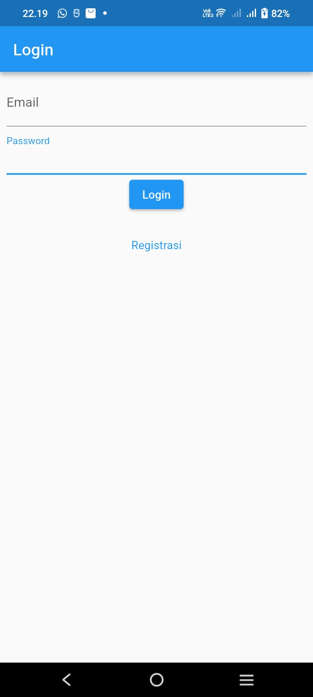

**d. Tampilan Daftar Produk**

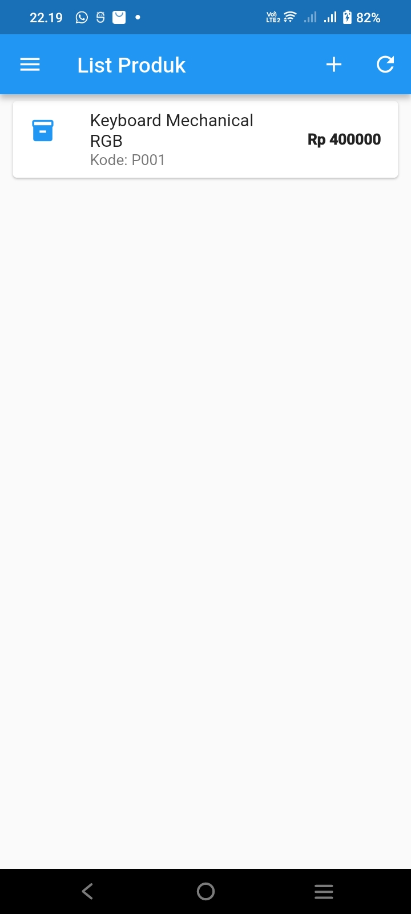

**e. Form Tambah Produk**

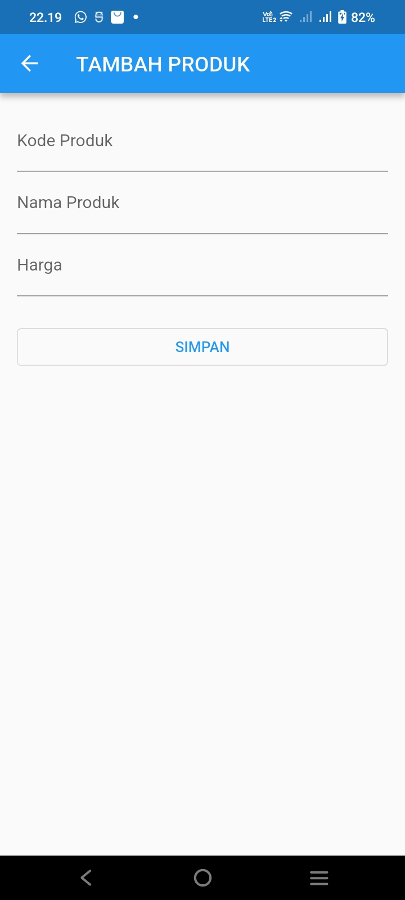

**f. Tampilan Detail Produk**

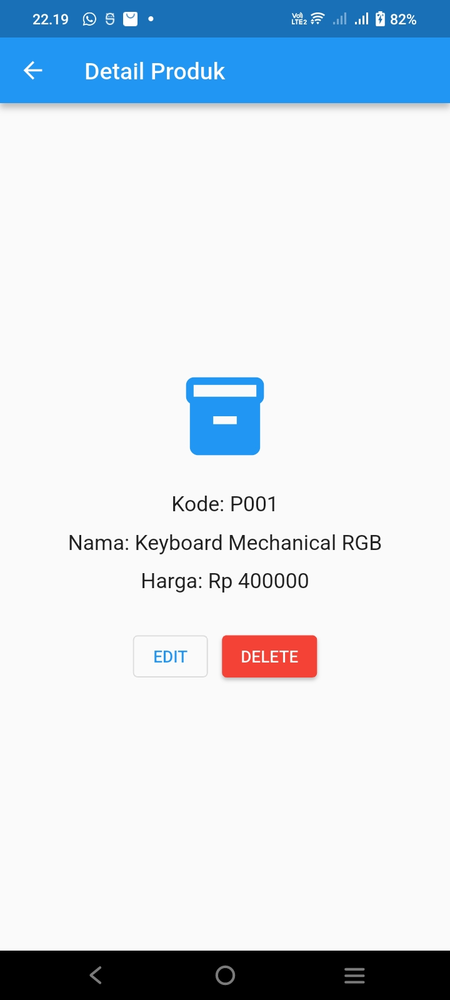

**g. Form Ubah Produk**

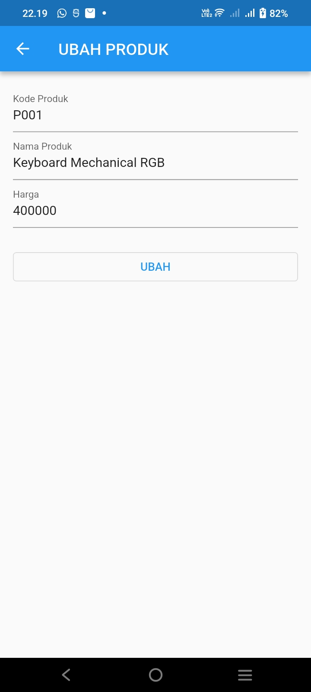

**h. Tampilan Daftar Produk Setelah Update**

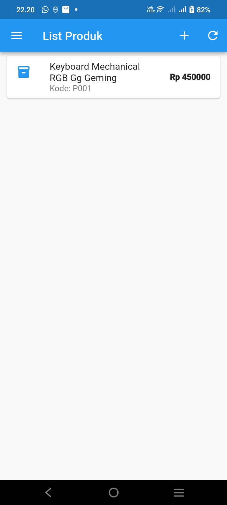

**i. Dialog Konfirmasi Hapus Produk**

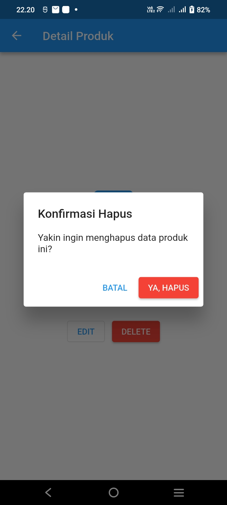

**j. Tampilan Daftar Produk Setelah Penghapusan**

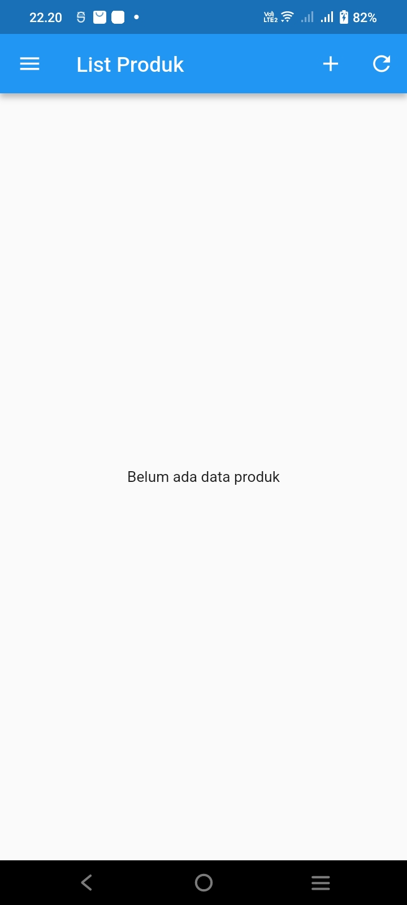


### Kesimpulan Praktikum

Pada Pertemuan 9, praktikum Modul 5 memberikan pemahaman mengenai proses integrasi aplikasi Flutter dengan REST API menggunakan backend CodeIgniter 4.

Materi yang dipraktikkan meliputi pembuatan konfigurasi endpoint API, penggunaan Bloc untuk mengelola komunikasi HTTP, pembuatan common dialog widget, penyimpanan token autentikasi, serta integrasi halaman registrasi dan login.

Selain itu, dilakukan integrasi operasi CRUD produk sehingga aplikasi Flutter dapat mengambil, menambahkan, menampilkan detail, mengubah, dan menghapus data produk secara langsung melalui REST API yang terhubung dengan database MySQL.

Pengujian dilakukan menggunakan perangkat Android fisik melalui koneksi USB. Hasil pengujian menunjukkan bahwa seluruh fitur utama aplikasi Toko Kita berhasil dijalankan dan berfungsi sesuai dengan kebutuhan praktikum.

Dengan demikian, aplikasi Toko Kita yang sebelumnya masih menggunakan data contoh pada antarmuka Flutter telah berhasil dikembangkan menjadi aplikasi yang terintegrasi dengan REST API CodeIgniter 4 dan database MySQL.